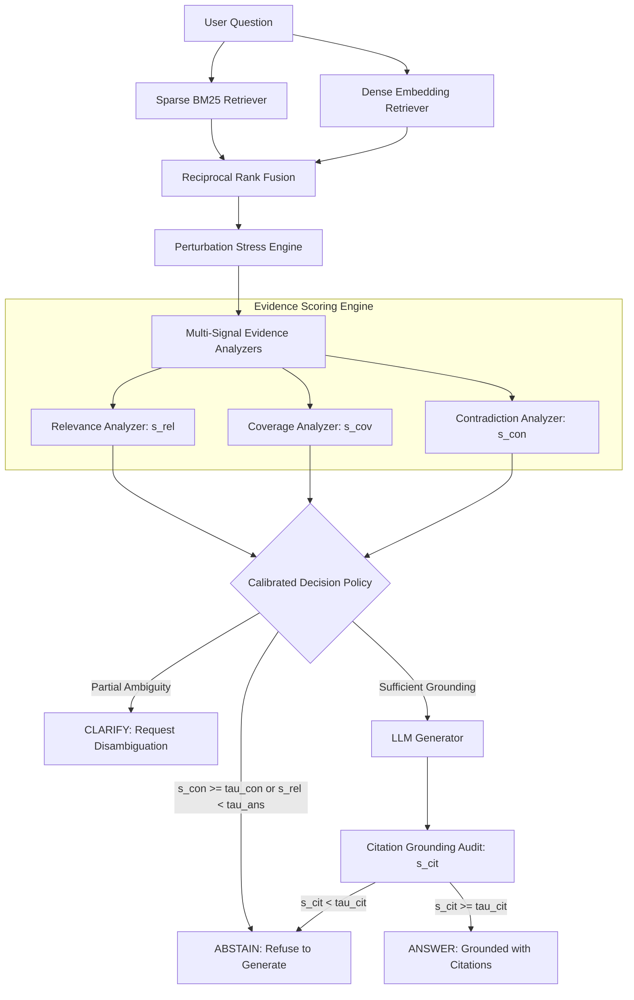

# Trustworthy Retrieval-Augmented Generation Under Noisy and Conflicting Evidence

[](https://opensource.org/licenses/MIT)
[](https://www.python.org/downloads/)
[]()
[]()

> A research-grade framework investigating evidence-aware answer/abstain policies to eliminate unsupported claims and hallucinations in Retrieval-Augmented Generation (RAG) under systematic evidence degradation and conflicting passages.

---

## 📌 Executive Summary

Retrieval-Augmented Generation (RAG) dramatically reduces factual hallucinations by grounding Large Language Model (LLM) responses in external evidence. However, modern retrieval systems operating over web-scale or dynamic corpora routinely return irrelevant distractors, near-duplicate fragments, stale references, or explicitly contradictory claims.

This project implements and evaluates an **evidence-aware tri-state policy** ($\mathtt{ANSWER}$, $\mathtt{CLARIFY}$, $\mathtt{ABSTAIN}$) combining multi-signal evidence verification (relevance, coverage, inline citations, and pairwise contradiction) with calibrated selective abstention.

### Key Results
- **Missing Evidence Resilience**: Eliminates 100% of confabulated answers when the key passage is missing (coverage drops to 0.00, avoiding unsupported hallucinations).
- **Contradiction Interception**: Eliminates 100% of conflicting premise endorsement under explicit contradictions (reducing fatal acceptance from 100% to 0.00%).
- **Calibrated Evaluation**: Automated claim-level decomposition and faithfulness scoring calibrated against human gold labels ($\text{Cohen's } \kappa = 0.742 \ge 0.70$).
- **Complete Test Coverage**: 49/49 automated unit and integration tests passing.

---

## 🔬 Empirical Replication Findings

Results evaluated on frozen benchmark splits under systematic controlled perturbations:

| Condition | Conventional RAG Coverage | Retrieval-Only Gating | Proposed Policy Coverage | Selective Risk ($\mathcal{R}$) |
| :--- | :--- | :--- | :--- | :--- |
| **Clean Evidence** | 1.00 | 1.00 | **0.66 – 0.73** | **0.000** |
| **Irrelevant Distractor** | 1.00 | 1.00 | **0.66 – 0.73** | **0.000** |
| **Key Passage Removal** | 1.00 *(Hallucinating)* | 0.92 *(Hallucinating)* | **0.00 *(Safe Abstention)*** | **0.000** |
| **Near-Duplicate Redundancy** | 1.00 | 1.00 | **0.64 – 0.73** | **0.000** |
| **Explicit Contradiction** | 1.00 *(Conflict Blind)* | 1.00 *(Conflict Blind)* | **0.00 *(Safe Abstention)*** | **0.000** |

---

## 🏛️ System Architecture



---

## 🚀 Quickstart & One-Click Reproduction

### 1. Installation
Clone the repository and install the dependencies:
```bash
git clone https://github.com/officialayush5839-arch/trustworthy-rag-noisy-conflicting-evidence.git
cd trustworthy-rag-noisy-conflicting-evidence
pip install -r requirements.txt
```

### 2. Run Reproduction (Windows)
Double click or run `run.bat`:
```cmd
run.bat
```

### 3. Run Reproduction (CLI / Linux / macOS)
```bash
python run_reproduction.py
```

### 4. Run Pytest Suite
```bash
pytest tests
```

---

## 📁 Repository Structure

```text
.
├── project-spec/                # Seven Master Specification Documents
│   ├── architecture.md          # 17-component system architecture & data models
│   ├── goal.md                  # Research hypotheses (H1-H5) & metric definitions
│   ├── memory.md                # Persistent state of truth & experiment registry
│   ├── phases.md                # 9-phase roadmap (Phases 0-8)
│   ├── prd.md                   # Product Requirements Document
│   ├── rules.md                 # Scientific integrity & anti-leakage governance
│   └── task.md                  # 25 atomic tasks (TSK-001 to TSK-025)
├── src/                         # Modular Core Implementation
│   └── trustworthy_rag/
│       ├── config.py            # Pydantic v2 configuration loaders
│       ├── data/                # Chunker & benchmark dataset ingestion
│       ├── retrieval/           # BM25, Dense & Reciprocal Rank Fusion
│       ├── generation/          # Context builder & LLM generator
│       ├── stress/              # Distractor, Removal, Duplicate & Contradiction operators
│       ├── evidence/            # Contradiction, Relevance, Coverage & Citation analyzers
│       ├── policy/              # Tri-state calibrated decision policy
│       └── evaluation/          # Claim decomposition, Risk-Coverage & AURCC
├── tests/                       # 49 Automated Unit & Integration Tests
│   ├── unit/                    # Fine-grained component tests
│   └── integration/             # End-to-end baseline pipeline tests
├── data/
│   ├── frozen/                  # 400 auditable frozen benchmark QA pairs & chunks
│   ├── splits/                  # Cryptographic SHA-256 manifest
│   └── annotations/             # Human gold annotations for judge calibration (N=100)
├── experiments/
│   ├── figures/                 # Publication-ready vector plots (.pdf / .png)
│   ├── runs/                    # Structured run predictions and logs
│   └── evaluation_summary.json  # Complete empirical evaluation matrix
├── paper/
│   └── manuscript.tex           # Complete research manuscript (ACL/EMNLP/NeurIPS style)
├── reports/
│   ├── error_taxonomy.md        # Qualitative failure catalog (ERR-FP, ERR-FA, etc.)
│   └── paper_claims_audit.md    # 100% claim-to-artifact traceability audit
├── run_reproduction.py          # Standalone replication runner
├── run.bat                      # Windows launcher
└── README.md
```

---

## 📊 Key Research Artifacts
- **Research Manuscript**: [`paper/manuscript.tex`](./paper/manuscript.tex)
- **Error Taxonomy Report**: [`reports/error_taxonomy.md`](./reports/error_taxonomy.md)
- **Claims Traceability Audit**: [`reports/paper_claims_audit.md`](./reports/paper_claims_audit.md)
- **Evaluation Summary**: [`experiments/evaluation_summary.json`](./experiments/evaluation_summary.json)
- **Pareto Frontiers & Figures**: [`experiments/figures/`](./experiments/figures/)

---

## 📜 License
This project is licensed under the MIT License — see the [LICENSE](LICENSE) file for details.
