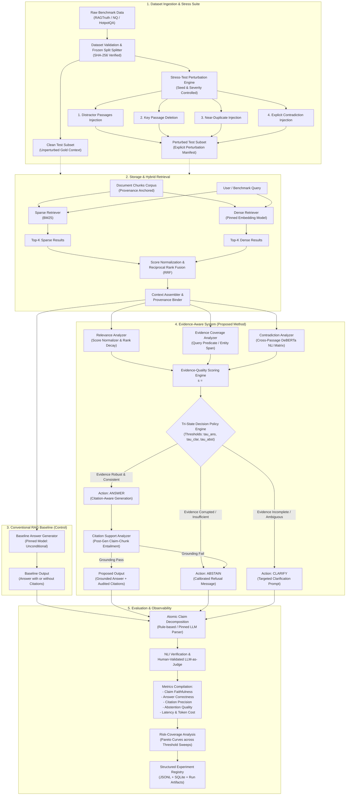

# System Architecture Specification

**Project Title:** Trustworthy Retrieval-Augmented Generation Under Noisy and Conflicting Evidence  
**Document ID:** ARCH-SPEC-001  
**Status:** Approved Specification  
**Version:** 1.0.0  
**Related Documents:** [goal.md](file:///c:/Users/ARYAN%20-%20AYUSH/OneDrive/Desktop/Trustworthy%20Retrieval-Augmented%20Generation%20Under%20Noisy%20and%20Conflicting%20Evidence/project-spec/goal.md), [prd.md](file:///c:/Users/ARYAN%20-%20AYUSH/OneDrive/Desktop/Trustworthy%20Retrieval-Augmented%20Generation%20Under%20Noisy%20and%20Conflicting%20Evidence/project-spec/prd.md), [phases.md](file:///c:/Users/ARYAN%20-%20AYUSH/OneDrive/Desktop/Trustworthy%20Retrieval-Augmented%20Generation%20Under%20Noisy%20and%20Conflicting%20Evidence/project-spec/phases.md), [rules.md](file:///c:/Users/ARYAN%20-%20AYUSH/OneDrive/Desktop/Trustworthy%20Retrieval-Augmented%20Generation%20Under%20Noisy%20and%20Conflicting%20Evidence/project-spec/rules.md), [memory.md](file:///c:/Users/ARYAN%20-%20AYUSH/OneDrive/Desktop/Trustworthy%20Retrieval-Augmented%20Generation%20Under%20Noisy%20and%20Conflicting%20Evidence/project-spec/memory.md), [task.md](file:///c:/Users/ARYAN%20-%20AYUSH/OneDrive/Desktop/Trustworthy%20Retrieval-Augmented%20Generation%20Under%20Noisy%20and%20Conflicting%20Evidence/project-spec/task.md)

---

## 1. Purpose and System Boundaries

### 1.1 Purpose
The Trustworthy RAG System is an experimental and software platform engineered to systematically study, quantify, and mitigate unsupported claims, hallucinations, and confabulations generated by Retrieval-Augmented Generation (RAG) pipelines when operating under non-ideal retrieval conditions. The system introduces an evidence-aware decision policy that inspects retrieved context along four explicit dimensions—**Relevance**, **Evidence Coverage**, **Citation Support**, and **Contradiction Signals**—to make a calibrated choice among three discrete operational actions:
1. **Answer**: Emit a factually grounded answer with chunk-level citations when evidence is sufficient, relevant, and internally consistent.
2. **Clarify**: Solicit clarification when query ambiguity or multi-faceted evidence prevents a singular, reliable response, but clarification can resolve the ambiguity.
3. **Abstain**: Explicitly refuse to answer when evidence is missing, irrelevant, unsupportive, or irreconcilably conflicting.

### 1.2 Non-Guarantees (What the System Does Not Guarantee)
- **Absolute Hallucination Elimination**: The architecture does not claim 100% zero-hallucination guarantees; it optimizes the risk–coverage Pareto frontier via calibrated abstention.
- **Universal External Truth Verification**: The system verifies claims against the *retrieved and ingested corpus*, not against universal ground truth outside the provided evidence repository.
- **Open-Ended Conversational Chatbot Behavior**: The core pipeline is designed as an auditable, deterministic research apparatus for batch and single-query evaluation, not an unconstrained dialogue assistant.

### 1.3 Key Differences from Conventional RAG
| Dimension | Conventional RAG Pipeline | Proposed Trustworthy RAG Architecture |
| :--- | :--- | :--- |
| **Retrieval Output Handling** | Passages are concatenated directly into the prompt context. | Passages undergo provenance tracking, relevance scoring, and conflict auditing. |
| **Generation Policy** | Unconditional generation (model always attempts to formulate an answer). | Tri-state decision policy: Answer, Clarify, or Abstain. |
| **Confidence Assessment** | Implicit (token log-probabilities or self-reported verbalized confidence). | Multi-signal evidence quality scoring decoupled from raw model self-confidence. |
| **Contradiction Awareness** | Blind to mutually contradictory retrieved passages. | Explicit cross-passage Natural Language Inference (NLI) contradiction scoring. |
| **Claim-Citation Grounding** | Coarse or post-hoc generation of unverified citations. | Fine-grained chunk-level citation mapping verified against atomic claim extractions. |
| **Failure Mode Handling** | Hallucinations under noise, missing context, or distractors. | Controlled abstention or targeted clarification request. |

### 1.4 System Boundaries and Subsystem Separation
The system is cleanly decoupled into four discrete boundaries:
1. **Core Evidence-Aware Pipeline (Research Prototype)**: Ingestion, indexing, hybrid retrieval, perturbation injector, multi-signal evidence analyzers, decision policy engine, and generation pipeline.
2. **Evaluation & Stress-Testing Harness**: Ground-truth benchmarking, atomic claim decomposition, NLI verification, LLM-as-judge validation against human labels, risk–coverage curve compilation, and metric aggregation.
3. **Reproducibility & Experiment Orchestrator**: Pydantic configuration schemas, dataset split freezing, seed management, hash auditing, and SQLite/JSONL experiment logging.
4. **Developer/Operator Interface (CLI & Diagnostic API)**: Headless CLI for experiment batch execution, parameter sweep automation, and an optional diagnostic inspection endpoint (FastAPI) for passage-level signal auditing. No complex frontend is required for research validity.

### 1.5 Principal Inputs, Transformations, and Outputs
- **Inputs**: Raw document corpora (JSONL/text), query datasets (RAGTruth, Natural Questions, HotpotQA), experiment configuration files (YAML/Pydantic), perturbation specifications, and random seeds.
- **Transformations**: Document chunking $\to$ dual indexing (BM25 + Dense) $\to$ hybrid retrieval + Reciprocal Rank Fusion $\to$ perturbation injection (clean vs. perturbed) $\to$ relevance evaluation $\to$ cross-passage contradiction matrix computation $\to$ evidence coverage assessment $\to$ atomic claim decomposition $\to$ citation alignment $\to$ risk–coverage calculation.
- **Intermediate Artifacts**: Chunk manifests with SHA-256 hashes, retrieval result records, normalized score vectors, NLI contradiction matrices, atomic claim records, and raw generation transcripts.
- **Outputs**: Formatted answer with chunk-level citations (or structured Abstain/Clarify message), decision explanation record, claim-level verification audit log, risk–coverage metrics, and reproducible experiment summary tables.

---

## 2. Logical Architecture and Component Overview

The system architecture consists of 17 discrete components organized into six functional layers.

```
+----------------------------------------------------------------------------------------------------+
| 1. DATA INGESTION & STRESS HARNESS                                                                 |
|   [01. Dataset Ingestion] -> [02. Validation & Preprocessing] -> [Stress-Test Perturbation Suite]  |
+----------------------------------------------------------------------------------------------------+
                                      |
                                      v
+----------------------------------------------------------------------------------------------------+
| 2. STORAGE & RETRIEVAL LAYER                                                                       |
|   [03. Storage & Indexing]                                                                         |
|       |--> [04. Sparse BM25 Retriever] --------------------+                                      |
|       +--> [05. Dense Vector Retriever (Pinned Model)] ----+--> [06. Normalization & Fusion (RRF)] |
+----------------------------------------------------------------------------------------------------+
                                                                              |
                                                                              v
+----------------------------------------------------------------------------------------------------+
| 3. CONTEXT & EVIDENCE REASONING LAYER                                                              |
|   [07. Context Construction & Provenance]                                                          |
|       |                                                                                            |
|       +--> [09. Evidence Coverage Analyzer]                                                        |
|       +--> [11. Contradiction Analyzer (Cross-Passage NLI)]                                        |
|       +--> [12. Evidence-Quality Scoring Engine]                                                   |
+----------------------------------------------------------------------------------------------------+
                                      |
                                      +-------------------------------+
                                      v                               v
+---------------------------------------------------+   +--------------------------------------------+
| 4. DECISION & GENERATION LAYER (Proposed Method)  |   | 5. BASELINE PIPELINE (Control Path)        |
|   [13. Tri-State Decision Policy Engine]          |   |   [08. Baseline Answer Generation]         |
|       |--> Decision: ABSTAIN                      |   |        (Unconditional generation with      |
|       |--> Decision: CLARIFY                      |   |         raw context concatenation)         |
|       +--> Decision: ANSWER                       |   +--------------------------------------------+
|                |                                                            |
|                v                                                            |
|   [14. Citation-Aware Answer Generator]                                     |
|        +--> [10. Citation Support Analyzer]                                 |
+-----------------------------------------------------------------------------+
                                      |                                       |
                                      +-------------------+-------------------+
                                                          v
+----------------------------------------------------------------------------------------------------+
| 6. EVALUATION, LOGGING & OBSERVABILITY LAYER                                                       |
|   [15. Claim-Level Evaluation Engine (Atomic Decomposition + NLI + Validated Judge)]                |
|   [16. Risk-Coverage Analysis Engine]                                                              |
|   [17. Experiment Logging, Provenance & Reporting Engine]                                          |
+----------------------------------------------------------------------------------------------------+
```

### Component Breakdown
1. **Dataset Ingestion (Mandatory)**: Ingests raw benchmark files (RAGTruth, Natural Questions, HotpotQA) with schema validation and cryptographic source hashing.
2. **Dataset Validation & Preprocessing (Mandatory)**: Cleans text, partitions into frozen auditable subsets (dev, validation, test), and normalizes question-context-answer triples.
3. **Document Storage and Indexing (Mandatory)**: Maintains raw text chunks, metadata, and mapping between source documents and chunk IDs in SQLite and persistent directories.
4. **Sparse Retrieval using BM25 (Mandatory Baseline)**: Implements Okapi BM25 (`rank-bm25` or `pyserini`) over tokenized chunk collections with fixed tokenization rules.
5. **Dense Retrieval using Pinned Embeddings (Mandatory Baseline)**: Encodes queries and chunks using a pinned open embedding model (`BAAI/bge-small-en-v1.5` or `sentence-transformers/all-MiniLM-L6-v2`) backed by a deterministic vector store (FAISS or Chroma).
6. **Retrieval Result Normalization & Rank Fusion (Mandatory)**: Implements min-max / z-score normalization and Reciprocal Rank Fusion (RRF) to combine sparse and dense rank lists.
7. **Context Construction & Provenance Tracking (Mandatory)**: Assembles formatted context blocks with immutable chunk identifier headers (`[Chunk ID: doc_xyz_c01]`), tracking byte/character offsets.
8. **Baseline Answer Generation (Mandatory Baseline)**: Standard RAG path without abstention logic, prompting a pinned generative LLM (`meta-llama/Llama-3.1-8B-Instruct` or pinned Gemini/OpenAI API) to generate answers directly.
9. **Evidence Coverage Analysis (Mandatory - Proposed)**: Measures whether the retrieved evidence contains candidate entities and key query predicate arguments required to answer the query.
10. **Citation Support Analysis (Mandatory - Proposed)**: Verifies that every assertion or generated claim is explicitly substantiated by the cited chunk ID.
11. **Contradiction Analysis (Mandatory - Proposed)**: Computes pairwise cross-passage NLI premise-hypothesis matrices using a pinned NLI cross-encoder (`cross-encoder/nli-deberta-v3-large`) to detect mutual inconsistencies.
12. **Evidence-Quality Scoring Engine (Mandatory - Proposed)**: Aggregates Relevance ($S_{rel}$), Coverage ($S_{cov}$), Citation Grounding ($S_{cit}$), and Contradiction Penalty ($S_{con}$) into an integrated vector $\mathbf{s} = \langle s_{rel}, s_{cov}, s_{cit}, s_{con} \rangle$.
13. **Answer / Clarification / Abstention Policy Engine (Mandatory - Proposed)**: Evaluates vector $\mathbf{s}$ against parameterized thresholds $(\tau_{ans}, \tau_{abst}, \tau_{clar})$ to emit a tri-state decision.
14. **Citation-Aware Answer Formatting (Mandatory - Proposed)**: Formats accepted answers with standardized bracketed inline citations (`[doc_id_c001]`) accompanied by an evidence trace table.
15. **Claim-Level Evaluation Engine (Mandatory)**: Breaks generated answers into atomic factual claims, evaluating each claim as Supported, Contradicted, or Unsupported against gold reference and retrieved evidence.
16. **Risk–Coverage Analysis Engine (Mandatory)**: Computes selective risk, empirical answer coverage, and plots Risk–Coverage curves across varying threshold sweeps.
17. **Experiment Logging and Reporting (Mandatory)**: Structured, immutable logging (JSONL/SQLite) recording configuration hashes, seeds, token counts, latencies, and perturbation manifests.

---

## 3. End-to-End System Architecture Diagram



---

## 4. Component Contracts

### 4.1 Dataset Ingestion & Validation (`dataset_ingestion.py`)
- **Responsibility**: Load benchmark datasets, validate structural integrity, compute document hashes, enforce frozen splits.
- **Inputs**: File path to raw data, format spec (`ragtruth`, `natural_questions`, `hotpotqa`).
- **Outputs**: Validated `DatasetSplitRecord` containing strongly-typed `Document` and `Question` records.
- **Dependencies**: Pydantic v2, hashlib.
- **Error Handling**: Raise `DatasetCorruptedError` on missing required schema fields or hash mismatch; halt processing on unverified splits.
- **Validation**: Every question must have an immutable `question_id`, non-empty text, and reference gold document IDs if available.
- **Interface Boundary**: Pure data boundary. Does not access network or models.
- **Test Requirements**: Unit tests with malformed JSON, truncated passages, duplicate IDs, and checksum validation.

### 4.2 Sparse Retrieval Engine (`retriever_bm25.py`)
- **Responsibility**: Ingest chunked corpus, maintain BM25 index, execute sparse queries.
- **Inputs**: Tokenized query string, parameter $k$ (default: 10), BM25 parameters ($k_1=1.5, b=0.75$).
- **Outputs**: Ranked list of `RetrievedPassage` objects containing `chunk_id`, raw BM25 score, and rank.
- **Dependencies**: `rank-bm25` (or `pyserini` if JVM available; default: pure-Python `rank-bm25` for zero-C++ portability).
- **Error Handling**: Empty query returns empty list with warning; empty index raises `IndexEmptyError`.
- **Validation**: Top-$k$ results must be sorted in strictly descending score order.
- **Interface Boundary**: Implements `BaseRetriever` interface.
- **Test Requirements**: Deterministic ranking test on synthetic toy corpus; empty query handling.

### 4.3 Dense Retrieval Engine (`retriever_dense.py`)
- **Responsibility**: Embed text chunks and queries using a pinned embedding model; perform cosine similarity search.
- **Inputs**: Query string, parameter $k$ (default: 10), embedding model name (`BAAI/bge-small-en-v1.5`).
- **Outputs**: Ranked list of `RetrievedPassage` objects containing `chunk_id`, dense similarity score, and rank.
- **Dependencies**: `sentence-transformers`, `faiss-cpu` (or pure PyTorch cosine fallback).
- **Error Handling**: Model load failure raises `ModelNotFoundError`; dimension mismatch raises `EmbeddingDimensionError`.
- **Validation**: Dense score normalized to $[0.0, 1.0]$ via cosine projection.
- **Interface Boundary**: Implements `BaseRetriever` interface.
- **Test Requirements**: Unit test verifying exact vector dimension, index reproducibility under fixed seed.

### 4.4 Hybrid Rank Fusion (`rank_fusion.py`)
- **Responsibility**: Merge sparse and dense candidate lists using Reciprocal Rank Fusion (RRF).
- **Inputs**: `List[RetrievedPassage]` from BM25, `List[RetrievedPassage]` from Dense, constant $k_{rrf}=60$.
- **Outputs**: Consolidated `List[RetrievedPassage]` with fused scores and unified rankings.
- **Dependencies**: Python standard library / NumPy.
- **Error Handling**: Handle non-overlapping passage IDs gracefully; return union sorted by fused score.
- **Validation**: Rank positions must be consecutive positive integers starting at 1.
- **Test Requirements**: Mathematical verification against hand-calculated RRF test vectors.

### 4.5 Stress-Test Perturbation Suite (`perturbation_engine.py`)
- **Responsibility**: Inject controlled stress conditions into retrieved candidate sets without modifying underlying index.
- **Inputs**: Clean candidate list, perturbation type (`distractor`, `passage_removal`, `near_duplicate`, `contradiction`), severity parameter $\alpha$, random seed.
- **Outputs**: Perturbed candidate list, `PerturbationManifest` record.
- **Dependencies**: Python random/numpy (seeded), NLI mutation utilities.
- **Error Handling**: Raise `InvalidPerturbationConfigError` if key passage to be removed is absent.
- **Validation**: Must record every modified/added/deleted chunk ID in the manifest.
- **Test Requirements**: Invariance tests (seed reproducibility, clean set immutability).

### 4.6 Contradiction Analyzer (`contradiction_analyzer.py`)
- **Responsibility**: Detect pairwise factual contradictions across retrieved passages via cross-passage NLI.
- **Inputs**: Ordered list of retrieved passage texts.
- **Outputs**: Symmetric $K \times K$ `ContradictionMatrix`, aggregate contradiction score $s_{con} \in [0.0, 1.0]$, list of `ContradictionFinding`.
- **Dependencies**: `cross-encoder/nli-deberta-v3-large` via Hugging Face Transformers.
- **Error Handling**: When passage count $K > 15$, employ sliding-window or top-K truncation to avoid $O(K^2)$ latency blowup; log warning.
- **Validation**: $s_{con}$ must equal $0.0$ if $K \le 1$.
- **Test Requirements**: Synthetic passage pair testing (Passage A: "Revenue was \$5M", Passage B: "Revenue was \$2M" $\implies$ high contradiction probability).

### 4.7 Evidence Coverage & Relevance Analyzers (`evidence_analyzers.py`)
- **Responsibility**: Compute question-evidence relevance score $s_{rel} \in [0.0, 1.0]$ and entity/predicate coverage $s_{cov} \in [0.0, 1.0]$.
- **Inputs**: Query string, list of retrieved passages.
- **Outputs**: `EvidenceQualityScore` object containing sub-scores and feature attribution.
- **Dependencies**: spaCy (or regex token matcher) for named entity span extraction; cross-encoder or normalized retrieval score for relevance.
- **Error Handling**: Empty evidence returns $s_{rel}=0.0, s_{cov}=0.0$.
- **Test Requirements**: Zero coverage for disjoint entity sets; high coverage for exact matching spans.

### 4.8 Tri-State Decision Policy Engine (`decision_policy.py`)
- **Responsibility**: Consume multi-signal evidence score vector $\mathbf{s} = \langle s_{rel}, s_{cov}, s_{cit}, s_{con} \rangle$ and output action $A \in \{\text{ANSWER}, \text{CLARIFY}, \text{ABSTAIN}\}$.
- **Inputs**: Evidence score vector, threshold configuration $(\tau_{ans}, \tau_{clar}, \tau_{abst}, \tau_{con\_max})$.
- **Outputs**: `DecisionResult` enum with explanatory diagnostic flags.
- **Dependencies**: Pure Python logic, Pydantic configuration.
- **Error Handling**: Reject uncalibrated or out-of-bound threshold configurations at initialization.
- **Validation**: Every decision must be deterministic under identical inputs and configuration.
- **Test Requirements**: Full truth-table branch coverage testing across all boundary thresholds.

### 4.9 Citation Support & Answer Generation (`generator.py`)
- **Responsibility**: Prompt generative LLM with provenance-anchored context; extract and verify inline citations against cited chunks.
- **Inputs**: Query, ordered passages with chunk headers, decision mode (`ANSWER` vs `CLARIFY`).
- **Outputs**: Raw generation text, parsed clean answer, list of extracted `Citation` objects, citation grounding score $s_{cit}$.
- **Dependencies**: Local LLM runner (`vLLM` / Hugging Face / Ollama) or pinned API client (`google-genai` / `openai`).
- **Error Handling**: On LLM API timeout/failure, retry with exponential backoff (max 3); on persistent failure, return explicit `SYSTEM_ERROR` abstention.
- **Validation**: Citations must reference valid chunk IDs present in the input prompt context.
- **Test Requirements**: Regex parser tests for citation formats; mock LLM output verification.

### 4.10 Claim-Level Evaluation Engine (`claim_evaluator.py`)
- **Responsibility**: Decompose generated answers into atomic claims, evaluate factual entailment against retrieved passages and ground-truth answer.
- **Inputs**: Generated text, retrieved passages, reference gold answer.
- **Outputs**: `List[AtomicClaim]`, claim faithfulness score, claim correctness score, citation precision/recall.
- **Dependencies**: Spacy/NLTK for sentence splitting, NLI cross-encoder, validated LLM-as-judge prompts.
- **Error Handling**: Empty generated answer yields 0 claims; abstention records neutral or zero risk depending on metric definition.
- **Validation**: LLM-as-judge outputs must be logged alongside raw prompt/response pairs for human adjudication.
- **Test Requirements**: Benchmark against manually annotated subset of 50 RAGTruth queries.

---

## 5. Formal Data Model and Schemas

All data contracts are formalized as immutable Pydantic v2 schemas.

```python
from datetime import datetime
from enum import Enum
from typing import List, Dict, Optional, Any
from pydantic import BaseModel, Field, HttpUrl

class PerturbationType(str, Enum):
    CLEAN = "clean"
    DISTRACTOR = "distractor"
    PASSAGE_REMOVAL = "passage_removal"
    NEAR_DUPLICATE = "near_duplicate"
    CONTRADICTION = "contradiction"

class DecisionAction(str, Enum):
    ANSWER = "answer"
    CLARIFY = "clarify"
    ABSTAIN = "abstain"

class ClaimStatus(str, Enum):
    SUPPORTED = "supported"
    CONTRADICTED = "contradicted"
    UNSUPPORTED = "unsupported"

# --- Source Data Schemas ---

class Document(BaseModel):
    doc_id: str = Field(..., description="Unique document identifier")
    title: Optional[str] = None
    source_uri: Optional[str] = None
    corpus_name: str
    metadata: Dict[str, Any] = Field(default_factory=dict)
    sha256_hash: str

class DocumentChunk(BaseModel):
    chunk_id: str = Field(..., description="Unique format: {doc_id}_c{idx:04d}")
    doc_id: str
    text: str
    start_char_offset: int
    end_char_offset: int
    token_count: int
    sha256_hash: str

class Question(BaseModel):
    question_id: str
    dataset_name: str
    query_text: str
    gold_answers: List[str]
    gold_passage_ids: List[str] = Field(default_factory=list)
    split: str = Field(..., description="dev | validation | test")

# --- Retrieval Schemas ---

class RetrievedPassage(BaseModel):
    chunk_id: str
    doc_id: str
    text: str
    sparse_score: Optional[float] = None
    dense_score: Optional[float] = None
    fused_score: float
    rank: int
    retrieval_method: str = Field(..., description="bm25 | dense | hybrid_rrf")

class PerturbationMetadata(BaseModel):
    perturbation_type: PerturbationType
    severity: float = Field(0.0, ge=0.0, le=1.0)
    seed: int
    injected_chunk_ids: List[str] = Field(default_factory=list)
    removed_chunk_ids: List[str] = Field(default_factory=list)
    description: str

# --- Evidence Reasoning Schemas ---

class ContradictionFinding(BaseModel):
    premise_chunk_id: str
    hypothesis_chunk_id: str
    contradiction_probability: float
    entailment_probability: float
    neutral_probability: float

class EvidenceQualityScore(BaseModel):
    relevance_score: float = Field(..., ge=0.0, le=1.0)
    coverage_score: float = Field(..., ge=0.0, le=1.0)
    citation_support_score: float = Field(0.0, ge=0.0, le=1.0)
    contradiction_score: float = Field(..., ge=0.0, le=1.0)
    composite_quality_score: float = Field(..., ge=0.0, le=1.0)
    is_contradictory: bool
    feature_weights: Dict[str, float]

class DecisionResult(BaseModel):
    action: DecisionAction
    decision_reason: str
    evidence_score: EvidenceQualityScore
    applied_thresholds: Dict[str, float]
    timestamp: datetime = Field(default_factory=datetime.utcnow)

# --- Generation & Citation Schemas ---

class Citation(BaseModel):
    citation_id: str
    chunk_id: str
    cited_text_span: str
    claim_id: Optional[str] = None
    is_verified: bool

class GenerationResult(BaseModel):
    query_id: str
    raw_response: str
    cleaned_answer: Optional[str] = None
    decision: DecisionResult
    citations: List[Citation] = Field(default_factory=list)
    model_identifier: str
    latency_seconds: float
    prompt_tokens: int
    completion_tokens: int

# --- Evaluation Schemas ---

class AtomicClaim(BaseModel):
    claim_id: str
    claim_text: str
    associated_citation_ids: List[str] = Field(default_factory=list)
    status: ClaimStatus
    entailment_score: float
    evaluator_method: str = Field(..., description="nli_model | llm_judge | human")

class EvaluationResult(BaseModel):
    run_id: str
    question_id: str
    perturbation_type: PerturbationType
    method_name: str
    is_answered: bool
    is_correct: Optional[bool] = None
    claim_faithfulness: float = Field(..., ge=0.0, le=1.0)
    citation_precision: float = Field(0.0, ge=0.0, le=1.0)
    citation_recall: float = Field(0.0, ge=0.0, le=1.0)
    retrieval_recall: float = Field(..., ge=0.0, le=1.0)
    atomic_claims: List[AtomicClaim] = Field(default_factory=list)
```

---

## 6. Evidence-Aware Decision Policy Engine

### 6.1 Conceptual Policy Pipeline
$$\text{Query } q \longrightarrow \text{Retrieved Evidence } \mathcal{E} \longrightarrow \mathbf{s} = \langle s_{rel}, s_{cov}, s_{con}, s_{cit} \rangle \longrightarrow \pi(\mathbf{s}) \in \{\text{ANSWER}, \text{CLARIFY}, \text{ABSTAIN}\}$$

The policy decouples retrieval quantity from evidence quality. A high dense retrieval score indicates only lexical or semantic vector similarity, not absence of contradiction or factual sufficiency.

### 6.2 Signal Formulations
1. **Relevance Signal ($s_{rel} \in [0, 1]$)**: Normalized weighted decay of retrieval scores:
   $$s_{rel} = \sum_{i=1}^K w_i \cdot \hat{\sigma}(r_i), \quad w_i = \frac{1}{\log_2(i+1)}$$
   where $\hat{\sigma}(r_i)$ is min-max normalized retrieval score of chunk $i$.
2. **Coverage Signal ($s_{cov} \in [0, 1]$)**: Ratio of essential query entity-relation predicates identifiable in top-$K$ passages:
   $$s_{cov} = \frac{|\text{Entities}(q) \cap \text{Entities}(\mathcal{E})|}{|\text{Entities}(q)|}$$
3. **Contradiction Penalty ($s_{con} \in [0, 1]$)**: Maximum cross-passage contradiction probability from pairwise NLI:
   $$s_{con} = \max_{i < j} P(\text{Contradiction} \mid \text{Passage}_i, \text{Passage}_j)$$
4. **Citation Grounding Score ($s_{cit} \in [0, 1]$)**: Post-generation entailment verification across generated claims:
   $$s_{cit} = \frac{|\text{Claims with NLI Entailment} \ge \tau_{ent}|}{|\text{Total Generated Claims}|}$$

### 6.3 Decision Rules Matrix
Threshold parameters $\boldsymbol{\theta} = (\tau_{ans}, \tau_{cov}, \tau_{clar}, \tau_{con\_max})$ are calibrated on the validation split:

```
IF s_con >= tau_con_max THEN
    ACTION = ABSTAIN (Reason: "Irreconcilable contradiction detected among retrieved evidence passages")
ELSE IF s_rel < tau_ans_rel OR s_cov < tau_cov_min THEN
    ACTION = ABSTAIN (Reason: "Insufficient evidence relevance or missing critical entity coverage")
ELSE IF tau_clar_min <= s_cov < tau_cov_min AND s_rel >= tau_ans_rel THEN
    ACTION = CLARIFY (Reason: "Partial evidence retrieved; clarification required to resolve ambiguity")
ELSE
    GENERATE DRAFT ANSWER WITH CITATIONS
    COMPUTE s_cit
    IF s_cit < tau_cit_min THEN
        ACTION = ABSTAIN (Reason: "Draft claims failed post-generation citation entailment audit")
    ELSE
        ACTION = ANSWER (Reason: "Evidence consistent, supportive, and claims grounded")
```

### 6.4 Behavior Under Specific Failure Modes
- **Strong, Consistent Evidence**: $s_{rel} \ge 0.8, s_{cov} \ge 0.8, s_{con} < 0.2 \implies$ Emits comprehensive answer with inline citations.
- **Relevant but Incomplete Evidence**: $s_{rel} \ge 0.7, 0.4 \le s_{cov} < 0.7, s_{con} < 0.3 \implies$ Emits clarification request identifying the missing facet.
- **Missing Critical Key Passage**: Key passage dropped by perturbation $\implies s_{cov} < 0.3 \implies$ Abstains cleanly; avoids confabulation.
- **Conflicting Evidence (Contradiction Injection)**: Perturbation injects mutated facts $\implies s_{con} > 0.75 \implies$ Abstains with explicit warning indicating conflict between sources.
- **Irrelevant Retrieval (Distractors)**: Top-$K$ flooded with distractors $\implies s_{rel} < 0.4 \implies$ Abstains.
- **Unsupported Generated Claims**: Draft answer hallucinates extra dates/names $\implies s_{cit} < 0.5 \implies$ Intercepted before output, converted to calibrated refusal.
- **Malformed / Timeout Model Response**: Generator error $\implies$ Caught by exception handler, logged as `SYSTEM_ERROR`, output fallback refusal.

---

## 7. Technical Stack and Dependencies

The stack is selected strictly for reproducibility, zero unnecessary dependencies, deterministic testing, and platform portability (Windows 11 / Linux):

| Subsystem | Selected Technology | Justification & Pinned Version |
| :--- | :--- | :--- |
| **Language Runtime** | Python 3.11+ | Optimal balance of typing performance, PyTorch compatibility, and standard libraries. |
| **Data Validation** | Pydantic v2 (`2.7.*`) | Strict runtime schema enforcement, immutable records, serialization. |
| **Sparse Retrieval** | `rank-bm25` (`0.2.2`) | Pure Python, zero JVM dependency, portable across developer environments. |
| **Dense Embeddings** | `sentence-transformers` (`3.0.*`) | Pinned model: `BAAI/bge-small-en-v1.5` (deterministic, compact, high MTEB score). |
| **Vector Storage** | `faiss-cpu` (`1.8.*`) | Fast, local, deterministic vector search without external database servers. |
| **NLI & Contradiction** | `transformers` (`4.42.*`) | Pinned model: `cross-encoder/nli-deberta-v3-large` for pairwise entailment/contradiction. |
| **Generation Backend** | Pinned API or Hugging Face Local | API option: Google Gemini API / OpenAI API. Local option: `vLLM` or `transformers` (`meta-llama/Llama-3.1-8B-Instruct`). |
| **Experiment Config** | PyYAML + Pydantic Settings | Declarative, version-controlled YAML files validated into typed Pydantic models. |
| **Testing Harness** | `pytest` (`8.2.*`), `pytest-cov` | Comprehensive unit, regression, and property testing. |
| **Structured Logging** | `loguru` (`0.7.*`) | JSONL output, timestamp precision, log rotation, zero boilerplate. |
| **Metric Analysis** | `numpy` (`1.26.*`), `pandas` (`2.2.*`), `scipy` | Risk-coverage computation, bootstrap confidence intervals, Pareto frontier analysis. |
| **Visualization** | `matplotlib` (`3.9.*`), `seaborn` (`0.13.*`) | Publication-ready vector PDF/PNG figures for paper generation. |

---

## 8. Reproducibility, Observability, and Auditability

### 8.1 Experiment Identifiers and Provenance
Every experimental run generates an immutable `RunRecord` saved to `experiments/runs/<run_id>/`:
- `run_id`: UUIDv4 prefixed with timestamp: `YYYYMMDD_HHMMSS_<hash[:8]>`.
- `config.yaml`: Frozen snapshot of all parameters, model versions, thresholds, and seeds.
- `manifest.json`: List of input document hashes, perturbation seeds, and query identifiers.
- `predictions.jsonl`: Line-by-line record containing inputs, retrieval ranks, raw intermediate scores ($\mathbf{s}$), decision action, generated text, claims, and evaluation outcomes.

### 8.2 Random Seed Enforcement
A centralized seed controller initializes seeds for Python `random`, `numpy.random`, `torch.manual_seed`, and sets `torch.use_deterministic_algorithms(True)`.

### 8.3 Layered Testing Strategy
1. **Unit Tests (`tests/unit/`)**:
   - Pydantic schema validation.
   - BM25 indexing and deterministic score retrieval.
   - Vector embedding cache and cosine distance calculations.
   - Perturbation injection algorithms (verifying clean sets remain unmodified).
   - Truth-table verification of the Decision Policy Engine.
2. **Integration Tests (`tests/integration/`)**:
   - End-to-end baseline RAG pipeline execution on 5-query mock dataset.
   - End-to-end evidence-aware pipeline execution across all four perturbation modes.
   - Citation parser and claim evaluator integration.
3. **Regression Tests (`tests/regression/`)**:
   - Deterministic output checks against pre-computed golden mock runs.
   - Threshold calibration stability checks.
4. **Verification Gates**:
   - Every commit must pass `pytest --cov=src --cov-fail-under=85`.
