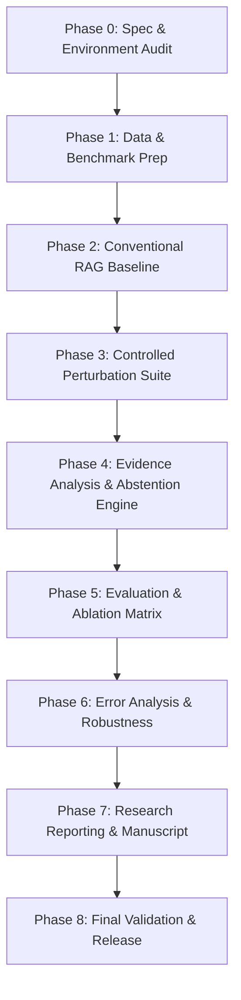

# Project Execution Phases and Stage-Gate Roadmap

**Project Title:** Trustworthy Retrieval-Augmented Generation Under Noisy and Conflicting Evidence  
**Document ID:** PHASE-SPEC-001  
**Status:** Approved Roadmap  
**Version:** 1.0.0  
**Related Documents:** [architecture.md](file:///c:/Users/ARYAN%20-%20AYUSH/OneDrive/Desktop/Trustworthy%20Retrieval-Augmented%20Generation%20Under%20Noisy%20and%20Conflicting%20Evidence/project-spec/architecture.md), [goal.md](file:///c:/Users/ARYAN%20-%20AYUSH/OneDrive/Desktop/Trustworthy%20Retrieval-Augmented%20Generation%20Under%20Noisy%20and%20Conflicting%20Evidence/project-spec/goal.md), [prd.md](file:///c:/Users/ARYAN%20-%20AYUSH/OneDrive/Desktop/Trustworthy%20Retrieval-Augmented%20Generation%20Under%20Noisy%20and%20Conflicting%20Evidence/project-spec/prd.md), [rules.md](file:///c:/Users/ARYAN%20-%20AYUSH/OneDrive/Desktop/Trustworthy%20Retrieval-Augmented%20Generation%20Under%20Noisy%20and%20Conflicting%20Evidence/project-spec/rules.md), [memory.md](file:///c:/Users/ARYAN%20-%20AYUSH/OneDrive/Desktop/Trustworthy%20Retrieval-Augmented%20Generation%20Under%20Noisy%20and%20Conflicting%20Evidence/project-spec/memory.md), [task.md](file:///c:/Users/ARYAN%20-%20AYUSH/OneDrive/Desktop/Trustworthy%20Retrieval-Augmented%20Generation%20Under%20Noisy%20and%20Conflicting%20Evidence/project-spec/task.md)

---

## 1. Roadmap Architecture and Governance

The research and development lifecycle is organized into nine sequential, dependency-aware phases (Phases 0 through 8). Each phase is governed by strict **Entry Criteria** and **Exit Gates**. 

> [!IMPORTANT]
> **Implementation vs. Scientific Validation**: Executable code is merely an engineering prerequisite. A phase is never complete simply because code runs without errors; scientific validation requires that experiments are executed, audited against frozen baselines, and backed by verifiable empirical data.

---

## Phase 0: Specification and Environment Audit

### 0.1 Objectives
- Establish the scientific and software foundations of the project.
- Validate workspace integrity and resolve all critical technical dependencies.
- Pin runtime environments, package manifests, and repository conventions.

### 0.2 Concrete Tasks
1. Complete and synchronize all seven master specification files in `project-spec/`.
2. Initialize Git repository with standardized `.gitignore` and branch protection rules.
3. Author `pyproject.toml` and pinned `requirements.txt` (Python 3.11+, Pydantic v2, PyTorch, Transformers, BM25, FAISS).
4. Create standard package directory layout: `src/trustworthy_rag/`, `tests/`, `configs/`, `data/`, `experiments/`.
5. Implement initial CI/CD workflow script and pre-commit hooks (formatting, linting, type-checking).

### 0.3 Deliverables & Artifacts
- Seven verified master specification Markdown files.
- `pyproject.toml` and lockfile with pinned versions.
- Standardized directory tree with package `__init__.py` files.
- Initial test suite running `pytest` with 100% pass rate.

### 0.4 Risks & Mitigations
- *Risk*: Dependency conflicts between PyTorch, CUDA, and Transformers on Windows.
- *Mitigation*: Pin CPU-compatible wheels as default with explicit optional GPU acceleration flags.

### 0.5 Entry & Exit Criteria
- **Entry Criteria**: Workspace initialized; project problem statement provided.
- **Exit Gate**: All seven specification files verified; `pytest` runs cleanly; environment reproducibility documented.

---

## Phase 1: Data and Benchmark Preparation

### 1.1 Objectives
- Acquire, validate, and freeze auditable subsets of RAGTruth and Natural Questions / HotpotQA.
- Implement strict Pydantic data schemas, text chunking, and cryptographic SHA-256 fingerprinting.
- Establish clean, frozen `dev`, `validation`, and `test` splits.

### 1.2 Concrete Tasks
1. Download RAGTruth corpus and QA subsets; download Natural Questions benchmark sample.
2. Implement `dataset_ingestion.py` with Pydantic v2 schema validation (`Document`, `Question`).
3. Implement text chunking pipeline (`chunker.py`) with byte-offset tracking and SHA-256 chunk IDs.
4. Freeze evaluation splits: Dev ($N=50$), Validation ($N=100$), Test ($N=250$).
5. Generate immutable split manifest `data/splits/manifest_sha256.json`.

### 1.3 Deliverables & Artifacts
- Frozen, versioned JSONL files in `data/frozen/`.
- Chunked passages corpus with offset tracking.
- Cryptographic hash manifest file.
- Automated data validation tests in `tests/unit/test_dataset_validation.py`.

### 1.4 Risks & Mitigations
- *Risk*: Data leakage between validation tuning sets and test evaluation sets.
- *Mitigation*: Cryptographically separate directories; prohibit threshold tuning on test splits via automated assertion.

### 1.5 Entry & Exit Criteria
- **Entry Criteria**: Phase 0 exit gate approved; environment operational.
- **Exit Gate**: Frozen dataset splits validated by unit tests; SHA-256 hashes verified; zero schema errors across all records.

---

## Phase 2: Conventional RAG Baseline

### 2.1 Objectives
- Construct an independently executable, measurable conventional RAG baseline.
- Implement sparse retrieval (BM25) and dense retrieval (pinned embedding model).
- Implement context assembly with chunk-level citation headers and unconstrained generation.
- Quantify baseline latency, token consumption, and initial hallucination rate.

### 2.2 Concrete Tasks
1. Implement BM25 retriever (`src/trustworthy_rag/retrieval/bm25.py`).
2. Implement dense retriever (`src/trustworthy_rag/retrieval/dense.py`) using `BAAI/bge-small-en-v1.5`.
3. Implement Reciprocal Rank Fusion (RRF) combiner.
4. Implement context builder injecting formatted chunk headers `[Chunk ID: doc_xyz_c01]`.
5. Integrate generator backend (`src/trustworthy_rag/generation/generator.py`) supporting local open model (`Llama-3.1-8B-Instruct`) and pinned API.
6. Execute baseline run over clean validation and test splits; record all outputs to `experiments/runs/EXP_BASELINE/`.

### 2.3 Deliverables & Artifacts
- Modular retrieval and generation codebase.
- Baseline configuration file `configs/baseline_rag.yaml`.
- Baseline output predictions database (`predictions.jsonl`).
- Baseline performance summary report (latency, token costs, initial accuracy).

### 2.4 Risks & Mitigations
- *Risk*: Generative LLM fails to include chunk citations in prompt context.
- *Mitigation*: Design strict few-shot system prompt instructing bracketed citation syntax.

### 2.5 Entry & Exit Criteria
- **Entry Criteria**: Phase 1 frozen data splits available.
- **Exit Gate**: Baseline pipeline runs end-to-end on test split; results logged in `memory.md`; baseline reproducible via single CLI command.

---

## Phase 3: Controlled Perturbation Suite

### 3.1 Objectives
- Engineer a deterministic stress-test suite implementing all four required perturbation conditions.
- Ensure strict separation between clean and perturbed evaluation datasets.
- Track perturbation manifests including seed, mutation type, and affected chunk IDs.

### 3.2 Concrete Tasks
1. Implement Distractor Injection operator: insert topically plausible but non-answering passages.
2. Implement Key Passage Deletion operator: identify and excise the essential gold supporting passage.
3. Implement Near-Duplicate Injection operator: insert semantically redundant, paraphrased chunks.
4. Implement Explicit Contradiction Injection operator: mutate key numerical/entity facts in supporting chunks to create direct contradictions.
5. Build test harness generating perturbed evaluation splits across severity levels ($\alpha \in \{0.2, 0.4, 0.6, 0.8\}$).
6. Verify perturbation manifests and assert immutability of clean gold reference data.

### 3.3 Deliverables & Artifacts
- Perturbation engine package `src/trustworthy_rag/stress/`.
- Four perturbed benchmark evaluation splits with corresponding manifests.
- Comprehensive unit and invariance tests in `tests/unit/test_perturbations.py`.

### 3.4 Risks & Mitigations
- *Risk*: Synthetic contradictions sound unnatural or fail to trigger semantic conflict.
- *Mitigation*: Use cross-passage NLI to verify that injected conflicting passages achieve high contradiction probability against gold passages before acceptance.

### 3.5 Entry & Exit Criteria
- **Entry Criteria**: Phase 2 baseline operational; gold supporting passage IDs verified.
- **Exit Gate**: All four perturbation operators pass automated invariance and validation tests; manifests cryptographically recorded.

---

## Phase 4: Evidence Analysis and Calibrated Abstention

### 4.1 Objectives
- Implement the proposed multi-signal evidence-scoring engine.
- Formulate relevance, coverage, citation grounding, and cross-passage contradiction analyzers.
- Integrate the tri-state decision policy engine (`ANSWER`, `CLARIFY`, `ABSTAIN`).

### 4.2 Concrete Tasks
1. Implement Cross-Passage Contradiction Analyzer (`src/trustworthy_rag/evidence/contradiction.py`) using `cross-encoder/nli-deberta-v3-large`.
2. Implement Relevance and Entity Coverage Analyzers (`src/trustworthy_rag/evidence/coverage.py`).
3. Implement Citation Grounding Analyzer (`src/trustworthy_rag/evidence/citation.py`).
4. Implement composite scoring engine and Decision Policy Engine (`src/trustworthy_rag/policy/decision.py`).
5. Implement targeted Clarification Generator for ambiguous/incomplete context.
6. Calibrate decision thresholds $(\tau_{ans}, \tau_{cov}, \tau_{clar}, \tau_{con})$ on the frozen validation split.

### 4.3 Deliverables & Artifacts
- Full evidence reasoning and decision policy module.
- Policy configuration schema `configs/policy_calibrated.yaml`.
- Threshold calibration report and diagnostic logs.
- Unit and integration tests covering all policy branches.

### 4.4 Risks & Mitigations
- *Risk*: Pairwise cross-passage NLI latency explodes with large top-$K$.
- *Mitigation*: Restrict pairwise checks to top-$K \le 8$ fused passages; apply sliding-window NLI heuristics for larger context.

### 4.5 Entry & Exit Criteria
- **Entry Criteria**: Phase 3 stress suite completed and verified.
- **Exit Gate**: Policy engine deterministically executes all three actions; unit tests achieve 100% decision branch coverage; thresholds calibrated strictly on validation data.

---

## Phase 5: Systematic Evaluation and Ablation Matrix

### 5.1 Objectives
- Execute full experimental matrix comparing the proposed method against all mandatory baselines.
- Conduct signal ablation studies isolating the contribution of each evidence signal.
- Compile empirical Risk–Coverage curves across multiple random seeds and perturbation draws.

### 5.2 Concrete Tasks
1. Implement Claim-Level Evaluation Engine (`src/trustworthy_rag/evaluation/claims.py`): atomic claim extraction + NLI entailment auditing.
2. Implement Risk–Coverage Curve compiler (`src/trustworthy_rag/evaluation/risk_coverage.py`).
3. Execute Mandatory Baselines on clean and perturbed test sets:
   - Baseline B1: Conventional RAG (unconditional generation).
   - Baseline B2: Retrieval-only thresholding (abstain if top-$1$ retrieval score $< \tau_{ret}$).
   - Baseline B3: Self-reported model confidence (verbalized confidence gating).
4. Execute Proposed Full Method: Multi-signal evidence policy across all perturbation conditions.
5. Execute Signal Ablations:
   - Ablation A1: Proposed without Contradiction Analyzer ($s_{con} = 0$).
   - Ablation A2: Proposed without Coverage Analyzer ($s_{cov} = 0$).
   - Ablation A3: Proposed without Citation Grounding ($s_{cit} = 0$).
   - Ablation A4: Proposed without Relevance Normalizer ($s_{rel} = 0$).
6. Execute multi-seed runs (seeds: 42, 137, 2024, 7, 99) and compute 95% bootstrap confidence intervals.
7. Conduct human validation on sample of $N=100$ claims to calibrate LLM-as-judge accuracy.

### 5.3 Deliverables & Artifacts
- Complete evaluation database `experiments/results_master.db` (and JSONL).
- Risk–Coverage curve data arrays and plot figures.
- Human annotation calibration report (Cohen's $\kappa$).
- Ablation impact summary table.

### 5.4 Risks & Mitigations
- *Risk*: API rate limits or GPU out-of-memory during multi-seed evaluation.
- *Mitigation*: Implement batch chunking, local response disk caching, and automatic retry with exponential backoff.

### 5.5 Entry & Exit Criteria
- **Entry Criteria**: Phase 4 policy engine calibrated; Phase 3 stress suite active.
- **Exit Gate**: All mandatory baseline, proposed, and ablation runs complete across all seeds; confidence intervals computed; human judge alignment verified ($\kappa \ge 0.70$).

---

## Phase 6: Error Analysis and Robustness

### 6.1 Objectives
- Establish an empirical taxonomy of RAG failure modes under noise and conflict.
- Analyze false positive answers (hallucinations that bypassed policy) and false abstentions (unnecessary refusals).
- Document boundary conditions, failure regimes, and limitations.

### 6.2 Concrete Tasks
1. Sample and inspect all instances of ungrounded answers emitted by the proposed policy.
2. Categorize failure root causes: subtle entity confusion, NLI premise truncation, over-strict coverage thresholds, or generator prompt defiance.
3. Quantify clarification effectiveness: did clarification queries request the missing factual predicate?
4. Document explicit negative results and scenarios where confidence-only or baseline RAG performed comparably to the proposed policy.

### 6.3 Deliverables & Artifacts
- Comprehensive Error Taxonomy Report `reports/error_taxonomy.md`.
- Catalog of analyzed failure cases with full passage and generation traces.
- Documented project limitations section for manuscript.

### 6.4 Risks & Mitigations
- *Risk*: Confirmation bias in error analysis.
- *Mitigation*: Adjudicate sampled errors using blinded human review.

### 6.5 Entry & Exit Criteria
- **Entry Criteria**: Phase 5 evaluation matrix results logged and frozen.
- **Exit Gate**: Error taxonomy completed; false positive and false negative rates quantified; negative findings recorded in `memory.md`.

---

## Phase 7: Research Reporting and Manuscript Preparation

### 7.1 Objectives
- Author the complete research paper manuscript conforming to top-tier AI conference standards (ACL / EMNLP / NeurIPS style).
- Generate publication-ready figures, tables, and statistical appendices.
- Conduct an evidence audit ensuring every claim in the paper is backed by recorded experiment runs.

### 7.2 Concrete Tasks
1. Generate publication-ready vector plots (PDF/EPS): Risk–Coverage Pareto frontiers, perturbation severity curves, ablation bar charts.
2. Format LaTeX tables summarizing main results, ablations, latencies, and token costs with 95% confidence intervals.
3. Draft manuscript sections: Introduction, Related Work, Problem Formulation, Proposed Architecture, Stress Protocol, Empirical Results, Error Analysis, Limitations, and Ethical Considerations.
4. Execute claim-to-artifact audit: verify that every number reported in the text maps to an exact artifact in `experiments/runs/`.

### 7.3 Deliverables & Artifacts
- Complete LaTeX manuscript source and compiled PDF.
- Automated figure and table generation scripts in `scripts/figures/`.
- Claim-to-artifact traceability audit log `reports/paper_claims_audit.md`.

### 7.4 Risks & Mitigations
- *Risk*: Discrepancies between drafted text and raw experiment logs.
- *Mitigation*: Automated script verifying that LaTeX table macros match values in `results_master.json`.

### 7.5 Entry & Exit Criteria
- **Entry Criteria**: Phase 6 error analysis and Phase 5 results verified.
- **Exit Gate**: Complete manuscript draft produced; 100% of reported numbers traceable to experiment registry; zero unverified assertions.

---

## Phase 8: Final Validation and Release Packaging

### 8.1 Objectives
- Package the entire codebase, configuration, and data pipelines into a clean, reproducible open-source release.
- Validate that an independent developer or researcher can replicate the primary experimental findings from scratch.
- Author comprehensive documentation, setup guides, and CLI execution tools.

### 8.2 Concrete Tasks
1. Author one-click reproduction script `run_reproduction.py` replicating core table results on a frozen benchmark subset.
2. Clean repository of temporary logs, caches, and scratch files.
3. Perform end-to-end reproduction test in a clean virtual environment.
4. Author comprehensive `README.md` and release documentation.
5. Create immutable archival bundle (source, configs, frozen splits, run manifests).

### 8.3 Deliverables & Artifacts
- Standalone reproduction script `run_reproduction.py`.
- Final validated repository release tag (`v1.0.0`).
- Comprehensive release documentation and replication guide.

### 8.4 Risks & Mitigations
- *Risk*: Reproduction fails on different OS or hardware environments.
- *Mitigation*: Test clean virtualenv setup on both Windows and Linux; provide Dockerfile container definition as optional fallback.

### 8.5 Entry & Exit Criteria
- **Entry Criteria**: Phase 7 manuscript completed and audited.
- **Exit Gate**: Clean virtualenv reproduction completes successfully; all test assertions pass; final release tagged.
