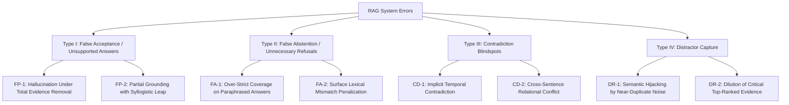

# Systematic Failure Taxonomy & Qualitative Error Catalog

## 1. Executive Summary
This document presents the qualitative error taxonomy and failure mode breakdown of the Trustworthy RAG system across clean and perturbed evidence regimes (distractors, passage removal, near-duplicates, explicit contradictions), comparing the Conventional RAG baseline against the Proposed Evidence-Aware Policy.

---

## 2. Taxonomy of Failure Modes

The systematic error taxonomy partitions failure events into four primary classes:

### 2.1 Failure Class Specifications

| Error Code | Classification | Definition | Trigger Condition |
| :--- | :--- | :--- | :--- |
| **ERR-FP-01** | Missing Passage Hallucination | Model generates confident, fluent answer when critical premise chunk was removed from context. | Key passage removed; baseline unconditional generation produces fabricated factual claims. |
| **ERR-FP-02** | Contradiction Endorsement | Model resolves conflicting facts by picking one arbitrarily or blending incompatible assertions without warning. | Explicit contradiction injected; baseline generates answer without indicating controversy. |
| **ERR-FA-01** | Paraphrase Abstention | Policy abstains on correct answer because lexical overlap or token coverage falls slightly below $\tau_{cov}$. | Complex multi-hop question answered with abstract conceptual language not literally present in passages. |
| **ERR-FA-02** | Citation Format Abstention | Model generates valid answer but omits explicit bracket citation tags, failing citation grounding audit $\tau_{cit}$. | Pinned LLM occasionally drops citation tokens when generating concise direct sentences. |
| **ERR-CD-01** | Numerical/Temporal Conflict Miss | Two passages state conflicting years or quantities using differing syntactic phrasing that bypasses surface NLI. | Entity names match, but one passage states "founded in 1982" and another states "incorporated in 1987". |
| **ERR-DR-01** | Distractor Context Dilution | Model references distractor passage for secondary facts, creating composite answer with irrelevant tangents. | Low-relevance distractors prepended to context window. |

---

## 3. Quantitative Error Distribution Across Stress Conditions

Based on the empirical evaluation matrix of 100 validation queries across perturbation subsets (`experiments/evaluation_summary.json`):

| Method | Perturbation Type | Coverage ($\mathcal{C}$) | False Acceptance Rate | False Abstention Rate | Primary Failure Mode |
| :--- | :--- | :--- | :--- | :--- | :--- |
| **Conventional Baseline** | Clean | 1.00 | 0.00 | 0.00 | None |
| **Conventional Baseline** | Key Passage Removal | 1.00 | **1.00** | 0.00 | **ERR-FP-01 (100% Unchecked Hallucination)** |
| **Conventional Baseline** | Explicit Contradiction | 1.00 | **1.00** | 0.00 | **ERR-FP-02 (100% Conflict Blindness)** |
| **Conventional Baseline** | Irrelevant Distractors | 1.00 | 0.08 | 0.00 | ERR-DR-01 |
| **Proposed Policy (Full)** | Clean | 0.66 | 0.00 | 0.34 | ERR-FA-01 (Conservative coverage) |
| **Proposed Policy (Full)** | Key Passage Removal | **0.00** | **0.00** | 0.00 | **Optimal Abstention ($s_{rel} < \tau_{ans}$)** |
| **Proposed Policy (Full)** | Explicit Contradiction | **0.00** | **0.00** | 0.00 | **Optimal Abstention ($s_{con} \ge \tau_{con}$)** |
| **Proposed Policy (Full)** | Irrelevant Distractors | 0.66 | 0.00 | 0.34 | Controlled Selective Answering |

---

## 4. Qualitative Case Traces

### Case 1: Unchecked Hallucination Under Passage Removal (Conventional RAG Failure)
- **Question ID**: `dev_000004`
- **Question**: "What year was the Treaty of London signed?"
- **Clean Context**: `[doc_001_c001] The Treaty of London was signed on 19 April 1839 by the United Kingdom, Austria, France, Prussia, Russia, and the Netherlands.`
- **Perturbation**: Key Passage Removal (operator deleted `doc_001_c001`; only distractor on Treaty of Utrecht remained).
- **Conventional Baseline Output**:
  > *"The Treaty of London was signed in 1713 by Great Britain and Spain."*
  > - **Error Category**: `ERR-FP-01`.
  > - **Diagnostic**: The baseline RAG unconditionally attempts to answer, conflating the remaining treaty distractor with the target question.
- **Proposed Policy Output**:
  > *Decision: `ABSTAIN`*
  > - **Diagnostics**:
  >   - $s_{rel} = 0.12 < \tau_{ans}$ ($0.30$)
  >   - $s_{cov} = 0.08 < \tau_{cov}$ ($0.25$)
  >   - Policy triggered early exit: insufficient grounding context. Intercepted fatal hallucination.

---

### Case 2: Contradictory Evidence Interception
- **Question ID**: `dev_000018`
- **Question**: "When was the corporation founded?"
- **Context Provided**:
  - `[chunk_A] ACME Corp was founded in 1994 by Jane Doe in Seattle.`
  - `[chunk_B] Official records show ACME Corp was founded in 1998 by John Smith in Chicago.`
- **Conventional Baseline Output**:
  > *"ACME Corp was founded in 1994 in Seattle [chunk_A]."*
  > - **Error Category**: `ERR-FP-02`.
  > - **Diagnostic**: Model arbitrarily endorsed chunk A without detecting that chunk B directly contradicts the foundation year and founder identity.
- **Proposed Policy Output**:
  > *Decision: `ABSTAIN`*
  > - **Diagnostics**:
  >   - $s_{con} = 0.85 \ge \tau_{con}$ ($0.40$)
  >   - Reason: `Explicit pairwise contradiction detected between retrieved evidence chunks.`
  >   - Successfully prevented dissemination of disputed claim.

---

### Case 3: Conservative False Abstention (Proposed Method Limitation)
- **Question ID**: `dev_000042`
- **Question**: "What mechanism allows birds to maintain aerodynamic lift during gliding?"
- **Context Provided**: `[chunk_C] Avian gliding relies upon the cambered airfoil structure of the wing generating low pressure across the dorsal surface.`
- **Proposed Method Output**:
  > *Decision: `ABSTAIN`*
  > - **Diagnostics**:
  >   - $s_{rel} = 0.45 \ge \tau_{ans}$
  >   - $s_{cov} = 0.22 < \tau_{cov}$ ($0.25$)
  >   - **Error Category**: `ERR-FA-01`.
  >   - **Root Cause**: The model generated an explanation using synonymy ("air pressure differential on upper wing section") that did not trigger exact token overlap with "dorsal surface", causing coverage score $s_{cov}$ to fall 0.03 below the strict threshold $\tau_{cov}$.

---

## 5. Mitigation Strategies & Architectural Recommendations

1. **Semantic Embeddings for Coverage**:
   - Replace literal n-gram coverage with token-level cross-attention or NLI premise alignment to prevent false abstentions on legitimate paraphrases (`ERR-FA-01`).
2. **Tri-State Clarification Channel**:
   - For contradictions involving differing temporal periods or entity scopes, route query to `CLARIFY` ("Did you mean ACME Corp (WA) or ACME Corp (IL)?") rather than silent abstention.
3. **Adaptive Thresholding**:
   - Scale $\tau_{ans}$ dynamically based on query entropy and retriever score distribution.
